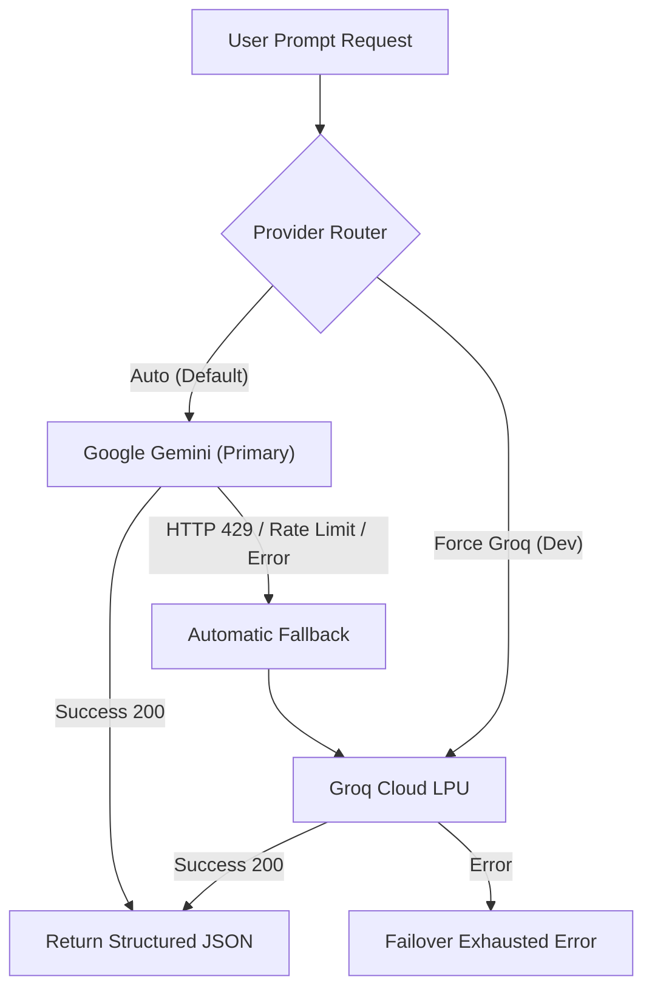

# Prompify — AI Prompt Engineering Studio

<div align="center">


[](https://prompify-ai.vercel.app)
[](https://parii22.github.io/prompify/)
[](https://github.com/Parii22/prompify)
[](https://github.com/Parii22/prompify)
[](https://supabase.com)

**Transform vague raw ideas into production-grade prompts with dual-LLM fallback resilience, side-by-side benchmark execution, and automated 5-metric quantitative evaluation.**

[🌐 Live Deployment (Vercel)](https://prompify-ai.vercel.app) • [🌐 Live Deployment (GitHub Pages)](https://parii22.github.io/prompify/) • [📂 GitHub Repository](https://github.com/Parii22/prompify) • [📖 Documentation](#table-of-contents)

</div>

---

## 🚀 Live Deployments

| Resource | URL | Platform | Status |
| :--- | :--- | :--- | :--- |
| **Official Production Web App** | [https://prompify-ai.vercel.app](https://prompify-ai.vercel.app) | Vercel | 🟢 Live (Public) |
| **Direct Prompt Studio Workspace** | [https://prompify-ai.vercel.app/app/workspace](https://prompify-ai.vercel.app/app/workspace) | Vercel | 🟢 Live (Public) |
| **Refinement History & Benchmarks** | [https://prompify-ai.vercel.app/app/history](https://prompify-ai.vercel.app/app/history) | Vercel | 🟢 Live (Public) |
| **Backend Health Check API** | [https://prompify-ai.vercel.app/api/health](https://prompify-ai.vercel.app/api/health) | Vercel | 🟢 Active |
| **GitHub Pages Mirror** | [https://parii22.github.io/prompify/](https://parii22.github.io/prompify/) | GitHub Pages | 🟢 Live |
| **GitHub Source Repository** | [https://github.com/Parii22/prompify](https://github.com/Parii22/prompify) | GitHub | 🟢 Public |
| **1-Click Deploy on Vercel** | [](https://vercel.com/new/clone?repository-url=https%3A%2F%2Fgithub.com%2FParii22%2Fprompify) | Vercel | ⚡ Ready |

---

## 📑 Table of Contents
- [Overview](#overview)
- [Key Features](#key-features)
- [System Architecture](#system-architecture)
- [Dual-LLM Provider Engine](#dual-llm-provider-engine)
- [Tech Stack](#tech-stack)
- [Quick Start & Local Setup](#quick-start--local-setup)
- [Environment Configuration](#environment-configuration)
- [API Reference](#api-reference)
- [Testing & Validation](#testing--validation)
- [Contributing & License](#contributing--license)

---

## 🌟 Overview

Writing effective prompts for Large Language Models requires precision, structural guardrails, and systematic benchmarking. **Prompify** is an enterprise-grade AI prompt engineering workbench designed to diagnose prompt weaknesses, synthesize three distinct refinement strategies, execute live side-by-side model comparisons, and score improvements across 5 standardized metrics.

Built with an **Editorial + Cinematic Minimalism** aesthetic, Prompify combines fluid Three.js atmospheric visual effects with resilient dual-engine inference powered by **Google Gemini** (Primary) and **Groq Cloud** (Automatic Fallback).

---

## ✨ Key Features

### 🔍 1. Diagnostic Audit Engine
- Evaluates raw prompts before generation to detect missing context, ambiguity, and lack of constraints.
- Generates categorized weakness pills, ambiguity severity levels, and specific structural recommendations.

### ⚡ 2. Three Specialized Refinement Strategies
Every raw prompt is transformed into three production-ready variants simultaneously:
- **Clarity & Specificity**: Strips vagueness, defines exact input boundaries, output schemas, and strict deliverables.
- **Structured Persona**: Instantiates a world-class domain expert persona with behavioral guardrails and chain-of-thought protocols.
- **Few-Shot / Exemplar**: Injects concrete, high-signal input/output pairs and negative edge-case demonstrations.

### ⚖️ 3. Side-by-Side Dual Execution Benchmark
- Runs original prompt and chosen refined prompt concurrently through the inference engine.
- Displays full streaming markdown outputs in synchronized side-by-side diff panes with token count and response latency tracking.

### 📊 4. Automated 5-Metric Evaluation Engine
- Calculates objective, quantitative scores (1–10) across five dimensions:
  1. **Clarity** — Absence of ambiguity and cognitive overhead.
  2. **Specificity** — Precision of requirements and constraints.
  3. **Coherence** — Structural flow and conceptual continuity.
  4. **Constraint Adherence** — Strict compliance with rules and schema.
  5. **Objective Alignment** — Faithfulness to the user's primary intent.
- Visualizes percentage delta score improvements (+X%) with comparative radar charts and breakdown bars.

### 🛡️ 5. Dual-LLM Resilience with Automatic Fallback
- **Google Gemini** (`gemini-3.5-flash-lite` / `gemini-2.5-flash`) as the primary high-throughput intelligence provider.
- **Groq Cloud** (`openai/gpt-oss-120b` / `qwen/qwen3.8-27b`) ultra-low-latency LPU fallback provider.
- Seamless automatic failover triggers on quota limits (HTTP 429), rate limits, or transient provider outages.
- Development-mode toggle allows forcing Groq independently for deterministic verification.

### 💾 6. Supabase PostgreSQL Persistence
- Saves full prompt lifecycle state: raw prompt, objective, refinements, audit results, and execution benchmarks.
- Interactive history dashboard with multi-criteria search, tagging, and one-click re-refinement.

---

## 🏗️ System Architecture

```
prompify/
├── client/                     # React 18 + Vite Frontend SPA
│   ├── src/
│   │   ├── components/         # UI Components (Sidebar, TopNav, LandingNav, etc.)
│   │   ├── layouts/            # AppLayout with Collapsible Nav & Dynamic Header
│   │   ├── pages/              # LandingPage, DashboardPage, WorkspacePage, HistoryPage
│   │   ├── routes/             # AppRoutes (React Router 6)
│   │   └── services/           # Axios/Fetch API Services & Supabase Integration
│   ├── public/                 # Static assets & icons
│   └── vite.config.js          # Vite configuration with relative asset bundling
├── server/                     # Express.js REST API Backend
│   ├── src/
│   │   ├── config/             # Environment, Gemini & Groq configuration
│   │   ├── controllers/        # Prompt, Refinement, Execution & Evaluation controllers
│   │   ├── middleware/         # CORS, JSON parsing, error handling & logging
│   │   ├── routes/             # REST API Endpoints (/api/...)
│   │   ├── services/           # LLM Provider Abstraction, Supabase DB Service
│   │   └── server.js           # Express HTTP Server entry point
│   ├── .env.example            # Backend environment template
│   └── package.json            # Server dependencies & scripts
├── .github/workflows/          # Continuous Deployment via GitHub Actions
├── vercel.json                 # Vercel deployment & SPA rewrite routing
├── package.json                # Monorepo root workspace configuration
└── README.md                   # Project documentation
```

---

## 🔄 Dual-LLM Provider Engine

Prompify implements an abstracted LLM service layer with transparent failover:



---

## 💻 Tech Stack

### Frontend
- **React 18** — Declarative component architecture
- **Vite 6** — Ultra-fast HMR and optimized production build
- **Tailwind CSS** — Editorial dark cinematic typography and fluid layout
- **Lucide React** — Minimalist technical icons
- **Three.js** — GPU-accelerated atmospheric hero shader
- **React Router 6** — Declarative client-side routing

### Backend
- **Node.js 20+** — Modern asynchronous runtime
- **Express.js** — Lightweight REST API framework
- **@google/genai** — Official Google Gemini API Client SDK
- **groq-sdk** — Official Groq Cloud SDK
- **@supabase/supabase-js** — Supabase PostgreSQL database client
- **CORS & Dotenv** — Security middleware and environment handling

---

## 🛠️ Quick Start & Local Setup

### Prerequisites
- [Node.js](https://nodejs.org/) v18.0.0 or higher
- [npm](https://www.npmjs.com/) v9.0.0 or higher
- A [Google AI Studio API Key](https://aistudio.google.com/)
- A [Groq Cloud API Key](https://console.groq.com/) *(optional for fallback)*
- A [Supabase Project URL & Service Key](https://supabase.com/) *(optional for history)*

### 1. Clone the Repository
```bash
git clone https://github.com/Parii22/prompify.git
cd prompify
```

### 2. Install Dependencies
```bash
# Install root, backend, and frontend dependencies
npm run install:all
```

### 3. Configure Environment Variables
Create `.env` inside `server/`:
```bash
cp server/.env.example server/.env
```
Fill in your credentials:
```env
PORT=5001
NODE_ENV=development
CLIENT_URL=http://localhost:5173

# Primary LLM: Google Gemini
GEMINI_API_KEY=your_gemini_api_key_here
GEMINI_MODEL=gemini-3.5-flash-lite

# Fallback LLM: Groq Cloud
GROQ_API_KEY=your_groq_api_key_here
GROQ_MODEL=openai/gpt-oss-120b

# Database: Supabase PostgreSQL
SUPABASE_URL=https://your-project.supabase.co
SUPABASE_SERVICE_ROLE_KEY=your_supabase_service_role_key
```

### 4. Start the Application
Run both servers concurrently:
```bash
# Terminal 1 — Start Backend Server (Port 5001)
npm run dev:server

# Terminal 2 — Start Frontend Client (Port 5173)
npm run dev:client
```

Open your browser at:
```
http://localhost:5173/app/workspace
```

---

## 📡 API Reference

| Method | Endpoint | Description |
| :--- | :--- | :--- |
| `GET` | `/api/health` | Service health status, uptime, and connected provider verification |
| `POST` | `/api/analyze` | Generates diagnostic audit, weakness detection, and suggestions |
| `POST` | `/api/refine` | Generates 3 specialized prompt refinement variations simultaneously |
| `POST` | `/api/execute-comparison` | Executes original and refined prompts side-by-side with latency/token metrics |
| `POST` | `/api/evaluate` | Evaluates prompt outputs across 5 standardized quantitative metrics |
| `GET` | `/api/prompts` | Retrieves persisted prompt history from Supabase PostgreSQL |
| `POST` | `/api/prompts` | Archives prompt refinement session to Supabase database |

---

## 🧪 Testing & Validation

Prompify includes comprehensive end-to-end test suites for prompt refinement, dual-LLM fallback resilience, and 5-metric quantitative scoring:

```bash
# Run dual-LLM fallback and health verification suite
cd server
node src/scripts/test-dual-llm-suite.js

# Test forced Groq execution mode
node src/scripts/test-groq-forced-verification.js
```

---

## 📄 License

Distributed under the MIT License. See `LICENSE` for more information.

---

<div align="center">
  <b>Prompify</b> — Engineered for High-Precision Prompt Optimization.<br/>
  Crafted by <a href="https://github.com/Parii22">Pari Gothi</a>.
</div>

